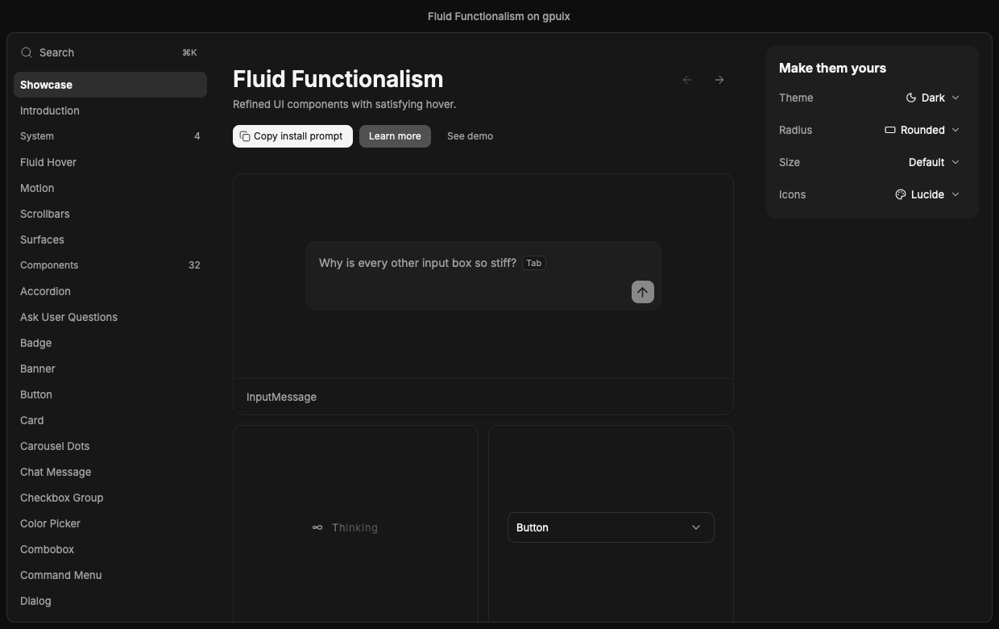
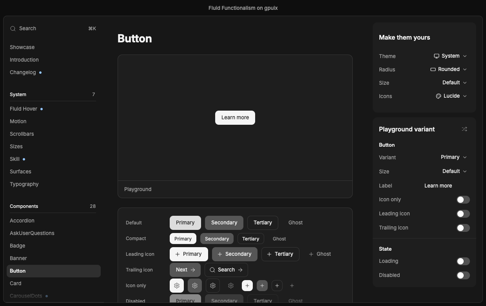
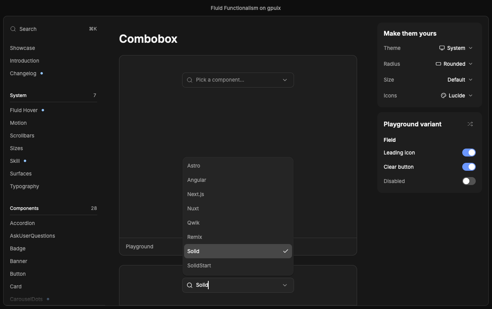
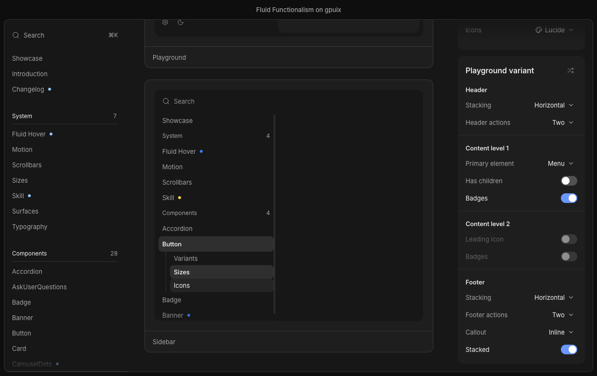

# gpuix + fluid functionalism

Can [gpuix](https://github.com/remorses/gpuix), a GPUI-backed renderer with no DOM and no CSS engine, draw the
[fluidfunctionalism.com](https://fluidfunctionalism.com) component library?

Yes. 32 demo pages cover every component of the library (37 component files, counting shared parts such as
choice-group and menu-item), in the light and dark schemes, with the site's fluid hover, springs and keyboard
behaviour. Around them sit the site's own pages: the home bento grid, Introduction, the seven system pages, Compare
with shadcn, the Concepts mockups, Audio Mixer, and ten doc-page playgrounds. Every place the port looks or behaves
differently from the source is recorded in [Drift from the source](#drift-from-the-source): 578 entries, each tagged
by cause (gpuix gap, port choice or not ported yet).

The components do not carry their own keyboard, selection, open-state and ARIA logic. That comes from
[base-ui-solid-gpuix](../base-ui-solid-gpuix), headless Base UI primitives for Solid, a sibling repository this one
consumes as source. This repository keeps the styling, the springs and the fluid hover.

| | |
|---|---|
|  |  |
|  |  |

## Run it

Needs Bun, pnpm, and two sibling checkouts next to this repository: the gpuix fork (`../gpuix`, `~/code/fdarian/gpuix`) and
`../base-ui-solid-gpuix`.

```bash
pnpm install    # from this directory only; see below
pnpm start
```

The app is a sidebar (Showcase, Introduction, Changelog, a System group, then one demo page per component, with the New dots of the latest release) plus a "Make them
yours" card with Theme (System follows the OS appearance), Radius, Size and Icons selects. The sidebar's Search row,
or ⌘K / Ctrl+K anywhere, opens the site menu: every page, the theme, a Recent group and a few actions in one field;
Compare, Concepts and Audio Mixer are reached from it. It sits in a browser-style frame: a transparent titlebar with
the traffic lights, a title across the top bar, and the page in a rounded panel. Inter is loaded from
`assets/fonts/`.

```bash
pnpm check                  # check:type (tsc), then check:scenarios
pnpm check:type             # tsc over src/ and scripts/, base-ui-solid-gpuix's source included
pnpm check:scenarios        # every scripts/check-*, about 30 minutes
pnpm screenshots [slug]     # headless captures of every demo and page into screenshots/<slug>/, about 25 minutes for all; or one slug
bun scripts/live-check.tsx  # the same flow against the real window, via gpuix's automation client
bun scripts/perf.tsx [slug...] --label name   # live frame times per page, idle and a sidebar sweep, into perf/<name>.json
```

<details>
<summary>How gpuix and base-ui-solid-gpuix are wired in</summary>

- **gpuix.** `@gpuix/native` and `@gpuix/solid` come from the fork at `~/code/fdarian/gpuix`: native is a `link:`, solid is a
  `file:` copy. The fork must be at `poc` 20a0c327 or later: the highlights and popups use its native `motion` springs, and the table, `inline-*`, container query, `has*` and `fit-content` layouts are its features,
  so rebuild the addon and the `@gpuix/solid` dist after pulling it (see the fork's `FORK.md`, "Building"), then run
  `pnpm install` here to refresh the copy. The Solid JSX transform is a Bun preload (`bunfig.toml`), so there is no
  build step.
- **base-ui-solid-gpuix.** A `link:../base-ui-solid-gpuix` dependency, and `pnpm-workspace.yaml` lists that folder as a
  workspace member. Its source is compiled with this repository's tsconfig and run by Bun directly.
- **One runtime instance.** Two copies of `solid-js` give two reactive systems and nothing updates; two of `@gpuix/solid`
  give two renderer registries. A `link:` of `@gpuix/solid` would resolve `solid-js` from the fork's own
  `node_modules`, so it is a `file:` copy whose peer resolves from this app, and `pnpm-workspace.yaml` points the
  copy's `@gpuix/native` back at the fork. A `file:` dependency gets a store path per project directory, so installing
  from `../base-ui-solid-gpuix` links a second `@gpuix/solid`: always install from this repository's root.
  `scripts/check-single-instance.ts` (one of the `check:scenarios` scripts) fails when either package resolves to more than one file.
- `pnpm` scripts run in `../base-ui-solid-gpuix` never auto-install (its `verifyDepsBeforeRun` is off); a bare
  `pnpm install` there links a second `@gpuix/solid`.
</details>

`scripts/screenshots.tsx <slug>` takes a file name from `src/demos/` or `src/pages/` (or `showcase`) and writes `initial.png`,
whatever the page's `scenarios` capture, `pill.png` (Radius on Pill), `compact.png` (Size on Compact) and `light.png`
(the page after flipping the theme through the real control; a full-layout page or one with its own rail has no theme
select, so the script sets Light in code). It runs on
gpuix's offscreen test renderer, so it needs the native addon but no window. `live-check.tsx` drives the real window
through the automation client and writes to `screenshots/live/`.

<details>
<summary>Known issue: the real window can fail to boot</summary>

With the display asleep, `bun src/main.tsx` crashes with `Fluid hover: painted bounds still unavailable`: no frame
is painted, so `getElementBounds` never returns a box. It reproduced at the first scaffold commit, which booted
fine earlier, so it is not a regression in the components. I suspect the macOS display-link frame loop does not tick
while the display sleeps, but that is unconfirmed. Run it with the screen awake.
</details>

## Build the app

Needs `cargo install cargo-packager --locked` once, on top of what "Run it" needs.

```bash
pnpm build    # scripts/build.ts
```

| Output | Size | What |
|---|---|---|
| `dist/fluid-functionalism` | 99 MB | The whole app as one binary (`Bun.build` compile, minified) |
| `bundle/Fluid Functionalism.app` | 99 MB | That binary wrapped by `cargo packager` (`packager.json`), with `dist/AppIcon.icns` made from `assets/icon/icon-1024.png`, the site's FF favicon |

About 30 MB of the binary is the `@gpuix/native` addon. Launch to first window, measured: 3.2 s the first time, about
1.4 s after.

<details>
<summary>What is embedded, and how</summary>

The binary reads nothing from the repository, so each kind of runtime input has one route in:

- **Demos, pages and the changelog** are the virtual modules `virtual:demos`, `virtual:pages` and `virtual:changelog`
  from `scripts/registry-plugin.ts`, which generate static imports of every file in `src/demos/`, `src/pages/` and
  `content/changelog/`. `bun src/main.tsx` uses the same generator, through `scripts/registry-preload.ts` in `bunfig.toml`.
  The build passes `scenarios: false`, so the `scenarios` exports are tree-shaken out; a `process.env.FF_PERF` define
  does the same for `src/lib/perf.ts`.
- **Fonts** are `import ... with { type: 'file' }` (`src/lib/fonts.ts`) and are read from `$bunfs`, Bun's embedded filesystem.
- **Images** go through `diskPath` in `src/lib/assets.ts`: gpuix's Rust image loader reads `` with `std::fs`,
  which cannot see `$bunfs`, so the file is copied to `$TMPDIR/fluid-functionalism-assets/` once per process.
- **The native addon** is embedded by Bun and extracted to `$TMPDIR` at launch. `@gpuix/native`'s ESM entry needs a
  workaround for that (see "Bugs" under the gpuix gaps).
</details>

## Adding a component

A component adds `src/components/<name>.tsx`, `src/demos/<name>.tsx` and `drift/<name>.md`, and edits no shared
file. `src/lib/demo.ts` reads every `src/demos/*.tsx` through the `virtual:demos` module (restart
`--hot` to pick up a new file), and the sidebar lists the demos by title. A demo file exports:

```ts
export const title = "Button";
export const group = "Components";
export function Demo(): JSX.Element {}              // one or more <DemoCard>s from src/lib/demo-kit
export const scenarios: DemoModule["scenarios"] = async (shot) => {};  // optional
```

`scenarios` drives `screenshots.tsx` with `shot.hover / click / down / up / press / moveTo / clickAt / scroll /
settle / expectText / capture`; see `ShotContext` in `src/lib/demo.ts`. Give elements a `testId` to target them.
An element inside a culled region has no painted bounds (`centerOf` throws), so `shot.reveal(testId)` first when a scenario scrolls toward one.
`drift/_TEMPLATE.md` is the shape of a drift file.

**Behaviour comes from base-ui-solid-gpuix, looks from here.** A component's keys, selection, open state, focus and ARIA
come from a `create*` primitive in `base-ui-solid-gpuix/<folder>` (`createSelectRoot`, `createMenuList`,
`createTabsRoot`, ...), which returns state accessors and prop objects to spread on gpuix elements. It has no styling,
tokens or animation. The component here adds what the site owns: tokens from `src/lib/theme.ts`, springs, the popup
chrome (`PopupSurface`, with `POPUP_EXIT_MS` from `src/lib/popup-timing.ts` handed to the primitive as an option), the
focus ring and fluid hover.

- **Fluid hover owns the highlighted row.** Pass `hover.activeIndex` as the primitive's `highlightedIndex` and
  `onHighlightChange(index, reason)` back into the hover; on a keyboard `reason`, call `hover.releasePointer()`. Picking
  the row nearest the pointer in the gap between rows (`pickNearest`) stays in `src/lib/fluid-hover.ts`.
- **A missing primitive goes into base-ui-solid-gpuix**, not into `src/`: its `UPSTREAM.md` says how to port one from
  Base UI, and its [BASE-UI-AUDIT.md](../base-ui-solid-gpuix/BASE-UI-AUDIT.md) records where it differs.
- **Components of this site's own** (command-menu, sidebar, nav-item, input-message, ask-user-questions, queued-stack)
  take shared helpers from base-ui where their behaviour matches: `moveIndex` and `edgeIndex` from
  `base-ui-solid-gpuix/internals/composite`, `createPresence` from `/internals`, `createPointerCapture` from `/utils`.
  Nested folders import the same way: `exports` maps `./*` to `./src/*/index.ts`.

A page (Introduction, a system page, a concept) is a file in `src/pages/` instead: it exports `title`, `group`
(`"Pages"` or `"System"`), `order`, `layout` (`"docs"` keeps the sidebar and right column, `"full"` fills the
window), `listed` (`"sidebar"`, `"menu"` for the site menu only, or `"none"`), `Page`, and optionally `Rail` (the right
column's card in place of "Make them yours"), `scenarios`, `menuIcon` and `menuKeywords`. `PageModule` in `src/lib/demo.ts` is the contract, `usePageNav()` from
`src/lib/page-nav.ts` navigates, and `src/lib/doc-page.tsx` holds the shared doc chrome.

<details>
<summary>Shared code in <code>src/lib/</code></summary>

| File | What it holds |
|---|---|
| `theme.ts` | Both columns of every `light-dark()` in `app/globals.css` (`color-mix()` mixed offline), type scale, radii, springs. `color.x` reads a `scheme` signal, so a JSX prop that touches it re-colours on a theme change; read tokens inside JSX or a function, never at module scope. `withAlpha`, `surface(level)`, `focusRing(offset)`. |
| `theme-fade.tsx` | `changeTheme(choice)`, what the Theme select, menu rows and Surfaces links call: mounts the 180ms colour cross-fade layer (`<ThemeFade />`, a `UniversalStyle`), flips the palette a frame later and drops the layer after 200ms. `setThemeChoice` still cuts at once, for captures and checks. |
| `fluid-hover.ts`, `fluid-highlight.tsx` | The site's `use-fluid-hover`: rows register with a `ResizeObserver`, their boxes are read with `getBoundingClientRect` when one reports, `pickNearest` (ported verbatim) resolves the pointer to a row including gaps, and one highlight glides between rows. `hover.containerProps` and `useHoverItem` wire a list. |
| `focus-ring.tsx` | The shared keyboard focus ring of accordion groups, tabs, tabs-subtle, checkbox, radio, select and the sidebar menu: one outline box 2px outside the focused row that springs between the rects fluid hover measures. `createFocusRing(hover)` collects `onFocus` / `onBlur` from the rows and counts only `event.focusVisible`, so a click draws none; the ring fades out 60 ms after the last blur and appears in place, not travelling from where it was. |
| `measured-height.ts` | A box whose height springs to its content's measured pixel height, as the source's do: the content box reports its size through `onLayout`, used by every collapse. gpuix animates `height: "auto"` itself; the port keeps the source's number. |
| `popup.tsx`, `popup-timing.ts` | Popup chrome on `<anchored fit="flip">` (`PopupSurface`, which takes a `createPresence` from base-ui and keeps its reported side and available height in `createPlacementState`), and the exit durations passed to the primitives. |
| `stable-label.tsx` | A label that gains weight without moving its neighbours: an `inline-grid` holds a hidden semibold copy and the visible one in one cell, so the label is as wide as the semibold copy and wraps like the source's; `nowrap` and `truncate` are opt-in. |
| `clock.ts` | One shared, ref-counted frame clock for every JS-driven loop; a subscriber inside a far culled region is skipped, and the timer stops when none is shown. |
| `fonts.ts`, `assets.ts`, `app-frame.tsx` | The static Inter files passed to `render()` and the test renderer, imported as embedded files; `diskPath`, which turns an embedded file path into one on disk for ``, and the image paths (`MICKA_PNG`, `OG_PNG`) built with it; the window frame (chrome-coloured bar, rounded page panel). |
| `press.tsx`, `icons.ts`, `icon.tsx` | The press-shrink fill layer; lucide glyphs as SVG strings (`defineIcon` for a component's own). |
| `site-command-menu.tsx`, `install-url.ts`, `platform.ts` | The site menu (a `CommandMenuDialog` of pages, theme, Recent and actions) and the window-wide Mod+K that toggles it, through gpuix's `window` event target; the registry URL the copy action writes; `IS_MAC` and `openUrl`. |
| `demo.ts`, `demo-kit.tsx`, `page-nav.ts` | The demo and page contracts, the card every demo page is made of, and `navigate` / `current` for pages. |
| `cull.ts` | The page scroller's contexts and `createCulling`, which hides a region's content while it is far from the scroller (`DemoCard`, `ComponentPreview`, home tiles, every `DocSection`, changelog entries and groups, Audio Mixer cards; regions nest, and a Size change re-measures them), and `OnScreenContext`, which loops read to hold still while hidden. |
| `doc-page.tsx`, `playground.tsx` | The docs chrome (`DocPage`, `DocSection`, `ComponentPreview`, `Code`) and the playground scaffolding (`PlaygroundLayout`, `PlaygroundPanel`, the control rows, the right-rail slot). |
| `icons.ts`, `icons/` | The Icons row: one glyph table per library, `iconSource` reads the picked one. |

Presence, list navigation (`moveIndex`, `revealRow`), typeahead, pointer capture, the hidden form value and the modal
`aria-hidden` marking are in base-ui-solid-gpuix (`internals/`, `floating-ui-solid/`, `utils/`), not in this folder.
</details>

## Drift from the source

The source is fluidfunctionalism.com at commit `0a0377e` (mickadesign/fluidfunctionalism, "Merge pull request #69");
a copy is kept at `~/.claude/notes/ff-source/`. Each file in [`drift/`](drift) lists every place the port looks or
behaves differently from it, whatever the cause. A cause is one of: **gpuix gap**, gpuix lacks it or gets it wrong;
**port choice**, the port differs on purpose; **not ported yet**, nothing stops the port doing it. An entry is a `## `
section with a Cause line, counted once; one that names two causes counts as mixed; one with no cause tag (an exact
or additive note) is not counted. `bun scripts/drift-counts.ts` prints the table below from the drift files. Base UI
behaviour, row by row, is in [`BASE-UI-AUDIT.md`](../base-ui-solid-gpuix/BASE-UI-AUDIT.md) in the sibling repository. Files named after a component are that
component's drift; `site` is the shell, and `home`, `introduction`, `compare`, `concepts`, `audio-mixer`,
`nav-menu`, `fluid-hover`, `motion-page`, `scrollbars-page`, `sizes-page`, `skill-page`, `surfaces` and
`typography` are the pages.

| Component or page | gpuix gap | port choice | not ported yet | mixed | total |
|---|---:|---:|---:|---:|---:|
| [accordion](drift/accordion.md) | 3 | 9 | 7 | 0 | 19 |
| [ask-user-questions](drift/ask-user-questions.md) | 2 | 4 | 7 | 3 | 16 |
| [audio-mixer](drift/audio-mixer.md) | 0 | 2 | 0 | 1 | 3 |
| [badge](drift/badge.md) | 1 | 3 | 0 | 0 | 4 |
| [banner](drift/banner.md) | 4 | 4 | 6 | 0 | 14 |
| [button](drift/button.md) | 3 | 4 | 2 | 1 | 10 |
| [card](drift/card.md) | 5 | 7 | 6 | 0 | 18 |
| [carousel-dots](drift/carousel-dots.md) | 2 | 3 | 2 | 1 | 8 |
| [chat-message](drift/chat-message.md) | 3 | 4 | 2 | 1 | 10 |
| [checkbox-group](drift/checkbox-group.md) | 3 | 0 | 3 | 1 | 7 |
| [color-picker](drift/color-picker.md) | 3 | 5 | 15 | 1 | 24 |
| [combobox](drift/combobox.md) | 5 | 13 | 5 | 2 | 25 |
| [command-menu](drift/command-menu.md) | 6 | 2 | 12 | 2 | 22 |
| [compare](drift/compare.md) | 2 | 8 | 1 | 2 | 13 |
| [concepts](drift/concepts.md) | 2 | 26 | 2 | 1 | 31 |
| [dialog](drift/dialog.md) | 3 | 2 | 2 | 1 | 8 |
| [dropdown](drift/dropdown.md) | 4 | 5 | 11 | 1 | 21 |
| [file-thumbnail](drift/file-thumbnail.md) | 1 | 4 | 1 | 1 | 7 |
| [fluid-hover](drift/fluid-hover.md) | 3 | 5 | 2 | 2 | 12 |
| [home](drift/home.md) | 0 | 1 | 1 | 2 | 4 |
| [input-copy](drift/input-copy.md) | 2 | 3 | 6 | 0 | 11 |
| [input-group](drift/input-group.md) | 1 | 1 | 3 | 1 | 6 |
| [input-message](drift/input-message.md) | 4 | 0 | 14 | 4 | 22 |
| [introduction](drift/introduction.md) | 0 | 4 | 2 | 1 | 7 |
| [mobile-drawer](drift/mobile-drawer.md) | 3 | 2 | 1 | 0 | 6 |
| [motion-page](drift/motion-page.md) | 3 | 3 | 1 | 3 | 10 |
| [nav-menu](drift/nav-menu.md) | 1 | 5 | 1 | 0 | 7 |
| [queued-stack](drift/queued-stack.md) | 4 | 2 | 3 | 1 | 10 |
| [radio-group](drift/radio-group.md) | 4 | 2 | 2 | 0 | 8 |
| [scroll-area](drift/scroll-area.md) | 2 | 5 | 1 | 1 | 9 |
| [scrollbars-page](drift/scrollbars-page.md) | 1 | 4 | 2 | 0 | 7 |
| [select](drift/select.md) | 5 | 3 | 6 | 2 | 16 |
| [sidebar](drift/sidebar.md) | 1 | 8 | 19 | 1 | 29 |
| [site](drift/site.md) | 5 | 11 | 21 | 7 | 44 |
| [sizes-page](drift/sizes-page.md) | 0 | 5 | 2 | 4 | 11 |
| [skill-page](drift/skill-page.md) | 3 | 5 | 0 | 1 | 9 |
| [slider](drift/slider.md) | 5 | 3 | 2 | 1 | 11 |
| [surfaces](drift/surfaces.md) | 2 | 3 | 4 | 3 | 12 |
| [switch](drift/switch.md) | 2 | 1 | 2 | 1 | 6 |
| [table](drift/table.md) | 3 | 1 | 3 | 0 | 7 |
| [tabs-subtle](drift/tabs-subtle.md) | 2 | 3 | 2 | 0 | 7 |
| [tabs](drift/tabs.md) | 2 | 2 | 2 | 0 | 6 |
| [thinking-indicator](drift/thinking-indicator.md) | 1 | 2 | 3 | 0 | 6 |
| [thinking-steps](drift/thinking-steps.md) | 4 | 3 | 6 | 1 | 14 |
| [tooltip](drift/tooltip.md) | 3 | 5 | 1 | 1 | 10 |
| [typography](drift/typography.md) | 6 | 0 | 1 | 4 | 11 |
| **Total** | **124** | **197** | **197** | **60** | **578** |

### gpuix gaps across components

These are the gpuix gaps that hit several components; the per-component files link here. They are as of
gpuix `poc` 20a0c327 (`~/code/fdarian/gpuix/FORK.md`): what the port used to work around and gpuix now does (tables,
`inline-*`, container queries, `has*` states, `fit-content`) is gone from this list. "Bug" means gpuix does something wrong or inconsistent; "missing" means it does not
offer it. A count is given only where the code shows it.

#### Bugs

| Used by | What | Workaround here |
|---|---|---|
| command-menu, and any list that keeps focus in a field while it is pressed | On Windows and Linux the press reaches JavaScript through a queue after native has already moved focus, so `preventDefault()` in `onMouseDown` or `onPointerDown` has no effect and a press on something not focusable still blurs the field (gpuix `README.md:3918-3926`). Seen in the command menu: clicking a tab blurs the field. macOS and the test renderer apply it | `preventDefault()` in `onMouseDown` on the list and the tab row (`drift/command-menu.md`); it works on macOS only. Not run on Windows or Linux |
| fluid-hover (the Show the math rules) | A border on one side only (`borderTopWidth: 1` with `borderTopStyle`) paints nothing on a box whose content height is 0, `solid` or `dashed`; the same box with a background paints, a box with all four sides styled paints, and so does one that is 2px tall. Measured on the test renderer | `height: 2`, so the content box is 1px (`drift/fluid-hover.md`, "Show the math") |
| slider | Values derived in JS (`createTransform` of several values) still trail their inputs by one frame (FORK.md:1262-1263) | none (`drift/slider.md`) |
| select, combobox | Enter in a form with two or more `<input>`s submits nothing: gpuix has no submit button, so HTML's fallback applies (gpuix `README.md:3602-3609`), and `FormValue` is a second `<input>` in every form that names a Select or Combobox. Enter in a lone `<input>` does validate and submit (an empty `required` one fires `invalid`; measured on the test renderer) | The demos submit through `requestSubmit()` |
| any `<input>` with `textAlign: "right"` (the Button playground's Label field) | The style is accepted and does nothing in the test renderer (`drift/button.md`, "Playground: no Active switch, Label field not right-aligned"); unverified in a live window | none: left-aligned |
| dropdown search field | A sticky box with a negative margin is held at its parent's content box, not at the border box the margin puts it (`drift/dropdown.md`, "Search field is a child of the scroller"): a `marginTop: -4` child of a `padding: 4` parent sits 4px low until the scroller moves it. Measured on the test renderer | The field is the scroller's first child, ahead of the padded list |
| banner (the actions, `drift/banner.md`, "Action order follows the written order") | Tab order follows the painted order under flex `order`, not the document order gpuix's README states (`README.md:6084`, `packages/native/js/host.ts:487`): three `tabIndex={0}` boxes with `order` 3, 2, 1 are visited right to left, where in CSS Tab keeps the markup order | `row` and `row-reverse` instead of `order`, which keeps the written Tab order (`src/components/banner.tsx:459-507`); placement follows position, not variant |
| banner (the actions) | `order` inside an `'@container'` block is ignored: the parent sorts its children by the style it reads without the block, so a container query cannot reorder | The narrow layout switches `flexDirection` in the block instead of `order` (`src/components/banner.tsx:501`) |
| thinking-steps (the details wrapper, `drift/thinking-steps.md`) | A `width: "fit-content"` box in a column flex container with a horizontal negative margin keeps the height of a wrapped first pass: 94x40 where CSS gives 94x20 | A block parent, as the source's, or `alignSelf: "flex-start"` (`src/components/thinking-steps.tsx:484-485`) |
| the changelog (`ChangelogView` down to `Entry`), any deep stack of auto-width columns | Nested `display: flex; flexDirection: 'column'` boxes with no definite width make layout cost grow ~1.9x per level: the changelog's chain of 8 columns drew in 121 ms. `width: '100%'` on the columns takes it to 20 ms (`Entry`'s outer column alone: 29 ms; `KindGroup`'s two alone: 23 ms). Repro: `scripts/perf-micro.tsx`, group `depth-col` | `width: '100%'` on each column wrapper in `src/pages/changelog/` (`changelog-view.tsx`, `release-section.tsx`, `entry.tsx`) |
| any box as wide as its text (`StableLabel`, the inline `Badge`, the ask-user inline title) | gpui measures text up to the next whole pixel, so a shrink-to-fit box is up to 1px wider than Chrome's and what follows it sits that much later (gpuix `README.md:3348-3350`, `FORK.md:799-801`) | none |
| any bold text in the system face (Helvetica Neue) | A bold Helvetica Neue line box is 24px in gpuix and 25px in Chrome; not measured for Inter | none |
| screenshots, app-frame | The test renderer opens its window with the options, but a capture is the view alone: no titlebar or traffic lights (gpuix `README.md:7059-7061`) | Captures show no traffic lights |
| screenshots | Batched keystrokes deliver an input's `onChange` after the whole batch | none |
| the compiled binary (`pnpm build`) | `@gpuix/native`'s ESM entry loads the `.node` addon through `createRequire(import.meta.url)`, which `bun build --compile` does not follow: the binary fails with "Cannot find native binding". Its CJS entry uses a plain `require`, which Bun embeds | `nativeCjsPlugin` in `scripts/build.ts` resolves `@gpuix/native` to `index.cjs` |

#### Missing features

| Used by | What | Workaround here |
|---|---|---|
| popups (select, combobox, dropdown, color-picker, dialog), tooltip, chevrons (accordion, card, color-picker, thinking-steps), scale-in entrances (banner, ask-user-questions, chat-message, input-copy, input-message, queued-stack, radio-group), spinners (file-thumbnail), the changelog's month dot (scale) and entry-name arrow (translate) | CSS transforms: no scale, rotate or translate, so the popups' `scaleY: 0.96` entrance and every turn and pop is impossible (Base UI audit rows 530, 617). The tooltip has no scale in the source (`tooltip.tsx:282-291`); it only slides on x / y, which is a transform too | Popups and the tooltip slide from the reported side and fade; glyphs swap, fade or are redrawn in SVG; panels move on `top` / `left` / `bottom` |
| slider | `<input type="range">` (Base UI audit row 312) | A pointer-handled track and thumbs |
| slider | `calc()`, or a `%` mixed with px, in a motion value: a string a motion value holds must be a colour or a percentage, so a `createTransform` that returns `calc(25% + 20px)` throws (gpuix `README.md:1531-1534`; `drift/slider.md`, "Derived layers trail their inputs"). `calc()` works as a static style, which does not animate | Pixel maths from the measured row width, in JS-derived values (one frame late, see Bugs) |
| select, combobox (`FormValue`) | `<input type="hidden">` | A real input that is invisible, unreachable and `aria-hidden` |
| every component that pads with a CSS shorthand string | Multi-value `padding` (and `margin`): the shorthands take one length, and `padding: "4px 8px"` throws "invalid length" when the batch applies (gpuix `README.md:5671-5673`; measured on the test renderer) | Longhands (`paddingTop`, `paddingLeft`, ...) |
| banner (the description layout), surfaces (the elevation stack) | Selector `:has(.x)` and group-has. gpuix has `hasHover`, `hasActive`, `hasFocus` and `hasFocusVisible`, which restyle an element from the state of its descendants, but not a selector such as the banner's `has-data-[slot=banner-description]`, and a parent's `has*` state cannot style its children (the surfaces' stack hides a label with `[&:has([data-surface]:hover)>span]`). The result matches the web; only the wiring differs | Banner: a context flag the description registers; surfaces: a pointer signal (`drift/banner.md`, `drift/surfaces.md`) |
| any component whose source writes `flex-1`, `flex-auto` or `flex-none` | The `flex` shorthand: `StyleDesc` has `flexGrow`, `flexShrink` and `flexBasis` only, so a source `flex: 1 1 0%` is three properties | The longhands, spelled out where the source writes `flex-1` |
| table | Collapsed-border transitions: a table part's styles are not animatable by `motion`, a keyframe or a CSS transition, so the row rule's 80ms fade is a snap where the source eases it | none: `fade(['border-color'], 80)` is declared and inert (`drift/table.md`) |
| not counted | `disabled` on anything but an input: other elements get `aria-disabled` only, so they stay focusable and clickable | `aria-disabled` plus the component's own guard |
| command-menu (and every long demo page) | Culling: elements a scroller clips away are still built, laid out and painted each frame, so a page of many menus costs several times a short one (`<virtual-list>` is the only exception) | `DemoCard`, every `ComponentPreview`, `DocSection`, changelog entry and group, Audio Mixer card and each home tile hide their content with `display: none` while far from the page scroller, through `createCulling` in `src/lib/cull.ts` (`drift/command-menu.md`) |
| file-thumbnail | A canvas pixel path (a PDF page preview) | The caller passes a type and the thumbnail shows a glyph |
| not counted | Effect groups (`filter`, `backdrop-filter`, `mask`, `clip`, group opacity) off macOS: the group draws flat. The Markdown sample's to-do tick is a `maskImage` of an SVG data URI on a foreground box, so off macOS it is a flat square | none |
| carousel-dots, file-thumbnail, thinking-indicator, thinking-steps | `requestAnimationFrame` itself (only `setTimeout`, FORK.md:209-211). The animations are possible without it, through motion values and keyframes (FORK.md:1144-1148) | `lib/clock.ts`: one shared, ref-counted `setInterval` frame clock |
| typography (the Balanced and Pretty demos), chat-message (the user bubble), fluid-hover (the callout copy) | `text-wrap: balance` and `pretty`: lines break greedily | The copy wraps natively; the fluid-hover callouts are broken by hand where the source's balance breaks them |
| badge | `text-box-trim` / `text-box-edge`: a label is centred by its full line box | Flex centring in a fixed-height pill (about a pixel of drift) |
| card (`CardTitle`), table, every `StableLabel` (tabs, tabs-subtle, sidebar, menu rows) | Variable-font axes (`fontVariationSettings`): only a font's default instance renders, so the weight cannot ease between 400 and 550 | Static cuts; the weight switches at once, SemiBold 600 for 550 |
| combobox (command-menu, input-message) | IME composition on Windows and Linux: gpuix reports `isComposing` `false` and fires no `Process` keydown or `composition*` events there, and the composition keys go to the input method before GPUI sees them (FORK.md:564-567). macOS reports all three (FORK.md:496-499), but this port reads none of them: the source's `isComposing` guards on Enter and arrows (command-menu, input-message, Base UI's combobox input) have no counterpart | none; IME input is untested. On macOS a key the input method takes first is a `Process` keydown that no `Enter` or arrow case matches |
| button (every `buttonProps` button) | A keyboard `:active` state: a held Space does not play the pressed look | none; Space still activates on key-up |
| thinking-steps | `filter` in `motion` targets: `blur()` paints as a static style but cannot be tweened | Opacity only |
| color-picker | A JS-visible CSS colour resolver: named colours and `color-mix()` resolve natively for styles only | `parseColor` reads hex, `rgb(a)`, `hsl(a)` and `oklch`; a name is rejected |
| queued-stack | An input-device signal: `matchMedia` fixes `hover` to `hover` and `pointer` to `fine`, so `(hover: none)` never matches | none; desktop only |
| combobox, select (any form) | A submit button: `SubmitEvent.submitter` is always `null` | The demos call `form.requestSubmit()` |
| skill page (the scripted-cursor examples) | Dispatching a synthetic pointer event, or setting `:hover`, on one element: the native simulate calls move the window's one pointer | The page calls the elements' `onMouseEnter` / `onMouseLeave` / `onMouseMove` props and `click()` directly (`drift/skill-page.md`, `src/pages/skill/scripted-pointer.ts`) |
| site menu (`isModK`) | A physical key on Windows and Linux: `code` there comes from GPUI's layout-dependent `key` assuming a US layout, so a non-Latin letter reports `code` `""` (`packages/native/src/events/key_names.rs:10-17`, `:161-169`; FORK.md:571-573). Ctrl plus a Cyrillic or Greek letter cannot match a shortcut through `code`, as the source's `matchesShortcut` does. macOS reports the physical key (FORK.md:553-554), but `isModK` reads `key` only, and ⌘K works there through the layout's Cmd letter | none; the sidebar's Search row opens the menu (`drift/site.md`). Not run on Windows or Linux |

## Harness and shared-lib notes

Quirks of this repo's own code, kept apart from the gpuix gaps above.

- **Frame-time harness** (`scripts/perf.tsx`, `src/lib/perf.ts`, on the real window; `FF_PERF=1 bun src/main.tsx` is its app half). Per page it mounts the app on that page (a fresh `render()`, not an in-app navigation), settles 1.5 s, then records 3 s idle and 3 s of 120 pointer moves per second sweeping the sidebar column. Columns: `draws/s` is the native draw count; `draw` is gpui's per-window-draw CPU time (build + layout + paint, not split) read from the overlay stats after each tick or injected move, so draws that share one tick are missed (`missedDraws` in the JSON; the overlay's own p90/p99/max cover all); `present/s` and `enc` are Metal frames and their encode ms from `GPUIX_RENDER_STATS`; `tick` is time inside `renderer.tick()` (the draw plus any event handler it runs); `apply` is time in `applyBatch` (the Solid mutations), `clock` time in `setInterval` callbacks (the `onFrame` subscribers); `cpu%` is whole-process CPU over wall time (above 100 means more than one thread); `nodes` is created minus destroyed elements counted from the mutation batches, since the real renderer has no element count. The numbers are only valid while the window is not occluded (a covered window gets no display link): the script retries a page that drew without presenting, and `--foreground` (focus-stealing) re-activates the window then; `--wait-visible s` sets how long it keeps trying. The addon must be a release build, which the script checks by size against cargo's artifacts. The frame loop is paced by the display (75 Hz here, 13.3 ms), so compare runs on the same machine and load.

- **Focus dimming.** gpuix dims every other focusable control while one has keyboard focus, so buttons, inputs and
  the tab and card wrappers set `keyboardFocusDim: false`.
- **Pointer events.** Filled and positioned boxes no longer block an ancestor's hover and press, so
  `pointerEvents: "none"` is left only where a browser needs it too: overlays above interactive siblings, the
  fluid highlights, a disabled cascade, the slider's press target, the hidden form input. The dropdown's submenu
  panel and the dialog and drawer popups opt back in with `"auto"`.
- **Overlays live inside the scrolled content.** Highlights and rows share a relative wrapper inside the scroller
  (combobox list), as in the DOM, where an absolute child of a scroller that is not its containing block does not
  scroll with the content. Rows are measured relative to that wrapper, so rects do not change as the list scrolls.
- **Escape.** `PopupSurface` joins gpuix's dismiss-layer stack while open, so Escape closes only the topmost popup,
  even inside a dialog.
- **Dialog.** gpuix's `Dialog` unmounts the instant `open` goes false, so `createDialogRoot`'s `mounted`
  (base-ui-solid-gpuix) outlives `open` and keeps the content through the fade. A non-modal dialog keeps its scrim, as in the source: gpuix's portal sets `pointerEvents: "none"` on a non-modal layer, so the backdrop opts back in with `"auto"`, and an outside press, the trigger included, lands on it and closes the dialog without reaching the page.
- **Screenshots run on the test renderer** (`scripts/screenshots.tsx`).
  - Captures show no traffic lights or native titlebar, because a test-renderer capture is the view alone.
  - The window is created with `appearance: "dark"` and the theme stays on System, so `initial.png` and every
    scenario capture are dark through `createAppearance`; `light.png` switches the theme with the real select, which
    calls `setAppearance("light")`. The script asserts `getAppearance()` for both and throws if the window disagrees.
  - `settle()` runs frames for real time, flushing the tree and draining native events each frame; a bare `flush()`
    never delivers `onMotionComplete`, so presence exits would never unmount. The first capture waits 800 ms.
  - Helpers read `getElementBounds` once per step to find an element's centre; nothing polls bounds. `shot.press`
    takes Playwright key names (`ArrowDown`, `Shift+Tab`) and `shot.scroll` the DOM's sign (positive scrolls down).
    There is no double-click or file-drop helper.
  - `shot.aria`, `expectAria`, `idOf`, `hasAriaNode` and `tabStopCount` assert on the accessibility tree.
  - Captures are not byte-stable: the text caret, timing-driven demos (thinking steps, shimmer, spinner), queue text
    and the playgrounds' `Math.random` variants vary run to run. Compare the content area with a pixel diff, not file hashes.

<details>
<summary>How the first three components translate (Tailwind to gpuix)</summary>

The Button, Combobox and Sidebar were ported first, with this table kept as they went. Most rows have since
been fixed in gpuix or generalised into the gpuix gaps above. Rows that say "not adopted yet" are things gpuix
now does that the port has not picked up.

| Tailwind / CSS | gpuix | Fidelity |
|---|---|---|
| `hover:` / `active:` on the same element | `style.hover` / `style.active`, applied natively | Exact |
| `group-hover:` (icon stroke, label colour) | `group: true` on the ancestor and `groupHover` / `groupFocusWithin` in the descendant's style (a name, `group: 'card'`, when groups nest), or `hasHover` and the other `has*` states on a parent styling itself, when the hover only drives a style. A signal from `onMouseEnter` / `onMouseLeave` remains when the hover feeds an `Icon` prop, a mount or unmount, or JS | Exact; the signal costs one JS round trip |
| `focus-visible:ring-1` | `style.focusVisible` outline, offset 1 | Exact |
| `ring-1 ring-border` | `outlineWidth` / `outlineColor`: outside the box, takes no layout | Exact |
| `transition-colors` (`duration-80`, or Tailwind's 150 ms), `transition-[box-shadow]` and the other lists | CSS `transition` on the element: `colorFade` (`src/lib/theme.ts`) is Tailwind's `transition-colors` list that gpuix animates (`color`, `background-color`, `border-color`, `outline-color`) over 80 ms on Tailwind's curve, `colorFadeDefault` the same over 150 ms, `colorFadeNoRing(ms)` the list without `outline-color` for a box-shadow focus ring, `springFade([...])` an 80 ms colour or outline fade on a curve fitted to `spring.fast` where the source animates it with a spring, and `fade([...], ms, ease?)` any other list (`box-shadow`, one colour, the source's own curve). Button's press-shrink fill (`PressFill`, `src/lib/press.tsx`) carries its own two-speed list on `top` / `right` / `bottom` / `left`, `border-radius` and `background-color`; the tertiary surface is `surfaceFade` / `pressFade`. A signal-driven change and a `hover` / `active` / `focusVisible` change both ease (`scripts/check-color-fade.tsx`). `text-decoration-color`, `fill` and `stroke` are not CSS-transitionable here; an icon's strokes follow `color` through `currentColor` (`<Icon fade>`) | Exact |
| spring `fast` / `moderate` (`motion/react`) | native `motion` spring, `{ type: "spring", duration: 0.08 / 0.16, bounce: 0 }`, velocity kept when the target changes mid-flight | Exact; `slow` (bounce 0.12, the exit 160 ms) drives the command menu's dialog and the banner |
| exits (`spring.fast.exit` …) | plain tweens, 60 ms / 120 ms, like the source | Exact |
| "snap, don't spring" on a reflow | a zero-length tween | Exact |
| `translate` / `x`,`y` travel of the highlight | `motion` on `top` / `left` / `width` / `height` (the only layout props it animates) | Equivalent, but it re-lays out per frame |
| `scaleY: 0.96` on popup enter | not possible, no transforms. Opacity plus the 4px slide stay (`top` −4 → 0) | Partly dropped |
| `z-index` (`z-10` rows over the highlights, `z-20` rings, `z-30` card actions, `-z-10` fills, `z-50` the Beacon popover) | `zIndex` on the element the source puts it on, positioned or a flex or grid item. gpuix orders it across stacking contexts as CSS 2 Appendix E (FORK.md Area C, "`zIndex` across stacking contexts"), so a control takes its `zIndex` inside a plain wrapper and a popover in a positioned box rises over a later sibling. An element that sets only `opacity`, `filter`, `mask` or `clip-path` forms a context as in CSS. Residuals: `getElementsAt` reads declared styles, so a `zIndex` a state style or a motion value sets is not seen there; the children of a custom element take no `zIndex` without a `position` | Exact |
| press-shrink: inset-px layer plus same-colour `box-shadow` spread | the element carries `margin: 1` and holds a `PressFill`: an absolutely positioned quad 1px outside it, with no `zIndex` and no stacking context, whose edges `groupActive` pulls to the element's own. The label is a `position: relative` box after the fill, so it paints over it as the source's `relative` label span does | Exact at rest and pressed; the edge steps at a pixel boundary instead of easing (quads snap to device pixels), over the same 80 / 180 ms |
| translucent fill (`--tint`, `bg-hover`) over that shadow | the same single quad: one primitive, so a translucent fill does not double up and a rounded edge has no seam (a `backgroundColor` plus a spread shadow are two primitives that antialias separately, a grey ring on every corner) | Exact |
| tertiary ring that moves inward on press (outer to inset shadow) | outline, offset 0 at rest and −1 pressed | Exact |
| `shadow-surface-N` (1px ring plus stacked drops; in dark an inset highlight and ring, and a 1px outer hairline) | `shadow(N)` (`src/lib/theme.ts`): the `--shadow-N` recipe as one multi-layer, scheme-aware `boxShadow` string, with no border. The popups, dialog, drawer, queued card, tab pill and composer use it at the source's levels | Exact |
| Tailwind `shadow-sm` to `shadow-xl` | `twShadow` (`src/lib/theme.ts`): both drops of each, as the CSS strings | Exact |
| `color-mix(in oklab, …)`, `light-dark()` | both columns kept as a token table; the scheme is a signal | Exact |
| `prefers-color-scheme` ("System" theme) | `createAppearance()` reads the OS appearance and `bindSystemScheme` feeds it to the `scheme` token. System / Light / Dark are one `themeChoice` signal, and `renderer.setAppearance` mirrors Light / Dark so the native chrome follows | Exact in the window and on the test renderer, which honours `appearance` and `setAppearance` |
| `prefers-reduced-motion`, `<MotionConfig reducedMotion="user">`, `useReducedMotion()` | `App` wraps the tree in gpuix's `<MotionConfig reducedMotion="user">`, which makes `width`, `height`, `top`, `right`, `bottom`, `left` and layout glides jump and leaves padding, margin, opacity, colours and radii animating: Motion's rule less the transforms the port does not have, so the tabs pills, the collapses and every other `motion.*` size and position animation land as the source's do. Where the source reads `useReducedMotion()` itself, the port reads `createReducedMotion()` at the same site: the fluid highlight, the accordion panel's fade, the banner, the carousel timer, the thinking indicator, the command-menu scroll and the scripted demos; the thinking-steps chevron too, a JS tween the config does not reach. What the source drives by CSS transition or by `animate()` on a motion value is not reduced there, so the scrollbar thumb and the switch thumb's slide sit in a nested `reducedMotion="never"` config. Pinned by `scripts/check-reduced-motion.tsx` | Exact for the properties; the OS setting is read on macOS only |
| Base UI `Positioner` (flip, `--anchor-width`, `--available-height`) | `<anchored fit="flip" deferred>`: gpuix picks the side and reports it with the room left (`onPlacement`), and `PopupSurface` caps the card to that room, slides from the reported side and is at least the trigger's width | Equivalent |
| `ScrollArea` (hover thumb, scroll fade) | a plain `overflowY: "scroll"` on the combobox list (Dropped); the sidebar's content is a ported `ScrollArea` with the fade and the end hairline | Dropped for the combobox; exact for the site nav |
| `getBoundingClientRect` | `element.getBoundingClientRect()`, read when needed (layout is flushed first, so it is never stale) | Native |
| `ResizeObserver` | gpuix's `ResizeObserver` (fluid hover, slider width, queued stack) and `onLayout` (size, after the first paint and on every change) | Exact |
| `text-[length:…] leading-[…]` | `fontSize` + `lineHeight` | Exact |
| `[text-box:trim-both_cap_alphabetic]` | none: labels are centred by their line box | Dropped, a pixel of optical drift |
| Inter variable (`wght 550`, `opsz`) | static Inter TTFs (400, 500, 600, 700) passed as `fonts` to `render()`; the family is `Inter` for every weight. the site's 550 is set as SemiBold 600, there is no `opsz` | Approximated, one weight step |
| ghost-span that reserves the semibold width | the same trick: `StableLabel` is an `inline-grid` with the hidden semibold copy and the visible label in one cell | Exact |
| `truncate` | `whiteSpace: "nowrap"` + `textOverflow: "ellipsis"` on the combobox rows | Exact; sidebar labels are not truncated |
| icon stroke 1.5 → 2 on hover | `<Icon easeStroke>` (`src/lib/icon.tsx`) animates `strokeWidth` on a `motion.g` over 80 ms: accordion, button, card, tabs, tabs-subtle, nav-item, sidebar, thinking-steps, input-copy, input-group, and the dropdown, dropdown-search, menu-item, select, combobox and command-menu icons. Everywhere else the SVG string is swapped | Exact where `easeStroke` is set, except with the phosphor library (filled paths, the weight switches at once); instant elsewhere |
| `animation: spinner-move` | a static lucide `loader`: no rotation, no animation. gpuix now has keyframes and `strokeDasharray` / `strokeDashoffset` motion (FORK.md:1144, :1151-1152); not adopted yet | Dropped, now possible |
| `AnimatePresence` exit of the popup | the popup stays mounted for 60 ms while its opacity fades | Approximated |

Not ported there (pill shape and the Radius, Size and Icons rows have landed since; Primitive is not ported):
multiple-select combobox and chips, rail resize, row actions, and `gapClick` (a
click between rows is not routed to the highlighted row).
</details>
